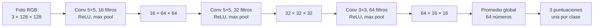

# Etapa 3: construir la CNN pequeña

La arquitectura en [`modelo.py`](modelo.py) reproduce la estructura `BeansCNN` del [taller UNTRM](https://github.com/lobaton/AI-Workshop-UNTRM/blob/main/session2_inside_the_black_box/src/cnn_common.py): tres bloques de **convolución → ReLU → max pooling**, promedio global y una capa lineal de tres salidas. Sus pesos se inicializan al azar; el aprendizaje será la etapa 4.



## Qué hace cada parte

1. **Convolución:** cada filtro recorre la imagen buscando un patrón local. Al comienzo, los números del filtro son aleatorios; durante el entrenamiento se ajustarán para ayudar a distinguir las clases.
2. **ReLU:** convierte las respuestas negativas en cero y deja pasar las positivas. Permite que la red combine patrones de forma no lineal.
3. **Max pooling:** conserva la respuesta mayor en cada región de `2 × 2`. Así el alto y el ancho se reducen a la mitad: `128 → 64 → 32 → 16`.
4. **Promedio global:** resume cada uno de los 64 mapas finales en un número. Esto evita una capa enorme que dependa de todos los píxeles finales por separado.
5. **Capa lineal:** transforma esos 64 números en tres puntuaciones, en el orden **mancha angular, roya del frijol, hoja sana**. Al inferir, `softmax` podrá convertirlas en porcentajes que sumen 100 %.

## Comprobación de formas y tamaño

Se ejecutó un recorrido con una entrada de prueba de forma `(1, 3, 128, 128)`: una foto, tres canales y 128 píxeles por lado.

| Paso | Forma de salida | Parámetros entrenables |
|---|---|---:|
| Bloque 1 | `(1, 16, 64, 64)` | 1.216 |
| Bloque 2 | `(1, 32, 32, 32)` | 12.832 |
| Bloque 3 | `(1, 64, 16, 16)` | 18.496 |
| Promedio global | `(1, 64)` | 0 |
| Clasificador | `(1, 3)` | 195 |
| **Total** | | **32.739** |

El número inicial de filtros es 16, igual al valor usado en la [práctica del taller](https://github.com/lobaton/AI-Workshop-UNTRM/blob/main/session2_inside_the_black_box/src/CNN_colab.ipynb). El modelo es considerablemente más pequeño que el ensayo preliminar de 89.603 parámetros.

## Cómo repetir la comprobación

Con PyTorch instalado, desde la raíz de este repositorio:

```powershell
python 03_modelo\modelo.py
```

La salida muestra las formas y el número de parámetros. No indica capacidad para clasificar aún, porque los pesos todavía no se entrenaron. En la etapa 4 conectaremos este modelo con los datos preparados y registraremos sus curvas de aprendizaje.

