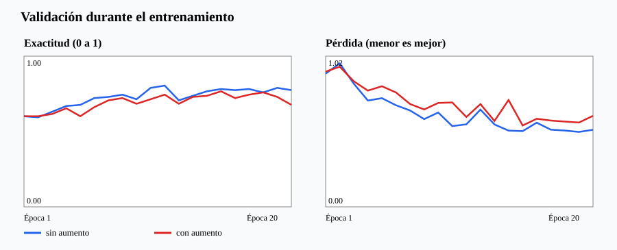

# Etapa 4: entrenar y seleccionar la CNN

Se entrenó la [CNN de la etapa 3](../03_modelo/modelo.py) con las 1.034 imágenes de entrenamiento y se observaron sus resultados en las 133 de validación. El [programa de entrenamiento](entrenar.py) **no carga las 128 imágenes de prueba**. Los dos experimentos usaron la misma arquitectura y configuración; solo cambió el aumento de datos.

## Configuración

| Elemento | Valor |
|---|---|
| Filtros iniciales | 16 |
| Parámetros del modelo | 32.739 |
| Épocas | 20 |
| Tamaño de lote | 32 |
| Optimizador | Adam |
| Tasa de aprendizaje | 0,003 |
| Función de pérdida | Entropía cruzada |
| Semilla | 0 |
| Criterio para guardar la mejor época | Menor pérdida de validación |
| Dispositivo usado | CPU |

En cada lote, la red produce tres puntuaciones. La entropía cruzada mide qué tanto se alejan de la etiqueta correcta. El optimizador Adam modifica los pesos para reducir ese error. Una época significa recorrer una vez las 1.034 fotos de entrenamiento. Al final de cada época se calcula pérdida y exactitud en validación, sin modificar los pesos con esas fotos.

## Comparación

| Entrenamiento | Mejor época | Pérdida de validación | Exactitud de validación |
|---|---:|---:|---:|
| Sin giros ni volteos | **19** | **0,50884** | **78,9 %** |
| Con giros y volteos | 15 | 0,55270 | 76,7 % |



Se eligió **sin aumento de datos** porque alcanzó la menor pérdida de validación, el criterio fijado antes de comparar. En estas 20 épocas y con esta configuración, los aumentos no mejoraron el resultado. Eso no demuestra que siempre sean perjudiciales: podrían comportarse distinto con otra duración, arquitectura o conjunto de fotografías.

Los resultados por época están en [`historial.json`](resultados/historial.json). Se guardaron los pesos de la mejor época de [la ejecución elegida](resultados/sin_aumento.pt) y de [la ejecución con aumentos](resultados/con_aumento.pt).

## Cómo reproducir

Desde la raíz de este repositorio, con `torch`, `numpy` y `Pillow` instalados:

```powershell
python 04_entrenamiento\entrenar.py --datos "C:\Users\LENOVO\Downloads\beans128"
```

El programa usa los datos preparados en la etapa 2 y guarda los resultados en `04_entrenamiento/resultados`. Para regenerar la figura:

```powershell
python 04_entrenamiento\graficar.py 04_entrenamiento\resultados\historial.json 04_entrenamiento\resultados\curvas.svg
```

La etapa 5 evaluará el modelo elegido en las 128 imágenes de prueba e inspeccionará las clases con más errores.

