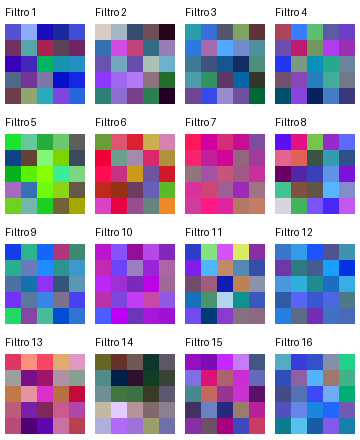
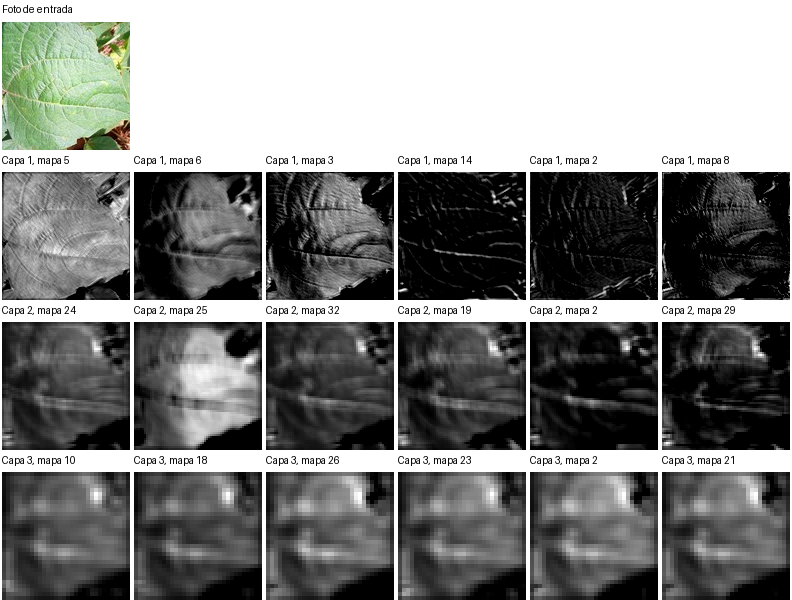

# Etapa 6: interpretar y usar la CNN

El programa [`interpretar.py`](interpretar.py) carga el modelo elegido en la [etapa 4](../04_entrenamiento/RESULTADOS.md), clasifica una foto y genera dos vistas de su interior. No modifica los pesos.

## Demostración

Se utilizó `1295_test_healthy.jpg`, una foto de hoja sana del grupo de prueba. El programa recibe sus píxeles; no utiliza la palabra `healthy` del nombre para decidir.

| Clase | Probabilidad estimada |
|---|---:|
| Mancha angular | 0,04 % |
| Roya del frijol | 0,02 % |
| **Hoja sana** | **99,94 %** |

El detalle generado se conserva en [`prediccion.json`](resultados/prediccion.json). Es un caso correcto, pero una probabilidad alta no garantiza que todas las fotos similares se clasifiquen bien: la [etapa 5](../05_evaluacion/RESULTADOS.md) encontró errores incluso con confianza alta.

## Qué muestran las vistas



Los **16 filtros de la primera capa** son matrices de `5 × 5` con tres canales de color. La figura amplía cada filtro y ajusta sus colores por separado para hacerlos visibles. Representa los pesos aprendidos, no fotografías de lesiones.



La segunda figura muestra la foto y seis mapas con mayor activación media en cada capa. Las zonas claras son respuestas más intensas **dentro de cada mapa**; cada mapa tiene su propia escala. En las capas posteriores la resolución espacial baja por el max pooling. Estas activaciones ayudan a explorar la red, pero no establecen por sí solas qué píxeles causaron la etiqueta final.

## Probar otra foto

Con `torch`, `numpy` y `Pillow` instalados, desde la raíz del repositorio:

```powershell
python 06_interpretacion\interpretar.py --imagen "C:\ruta\de\tu_hoja.jpg"
```

La foto se convierte a RGB, se recorta por el centro a un cuadrado, se ajusta a `128 × 128` y se normaliza a `[-1, 1]`. El recorte puede eliminar una lesión si está cerca del borde; conviene revisar la foto antes de interpretar el resultado. El programa escribe `prediccion.json`, `filtros.png` y `mapas.png` en `06_interpretacion/resultados`.

La red solo conoce tres etiquetas. Si recibe otra planta o una foto muy distinta a las del entrenamiento, igualmente elegirá una de ellas. Para reconocer casos desconocidos habría que ampliar el conjunto de datos y modificar la evaluación.

